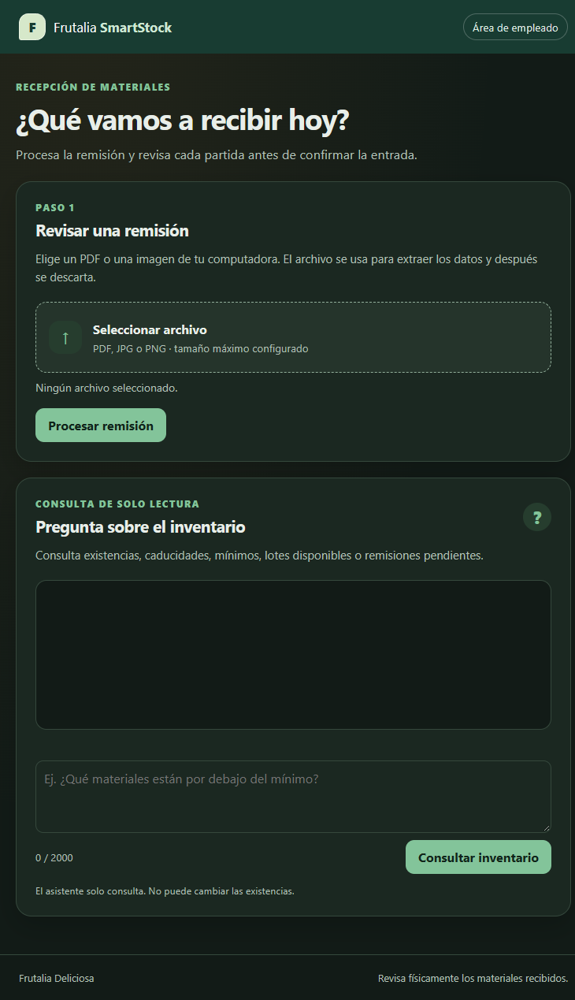
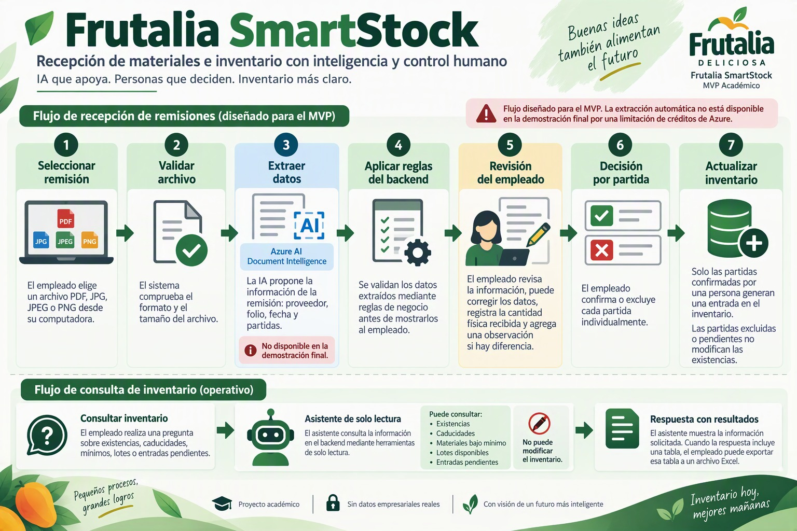
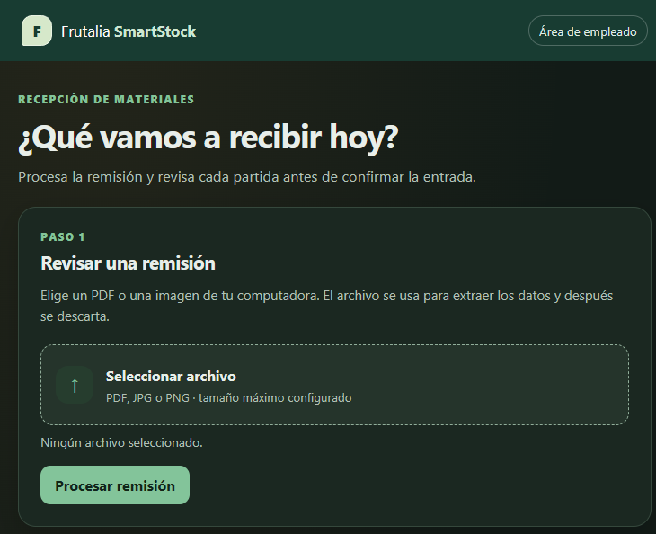
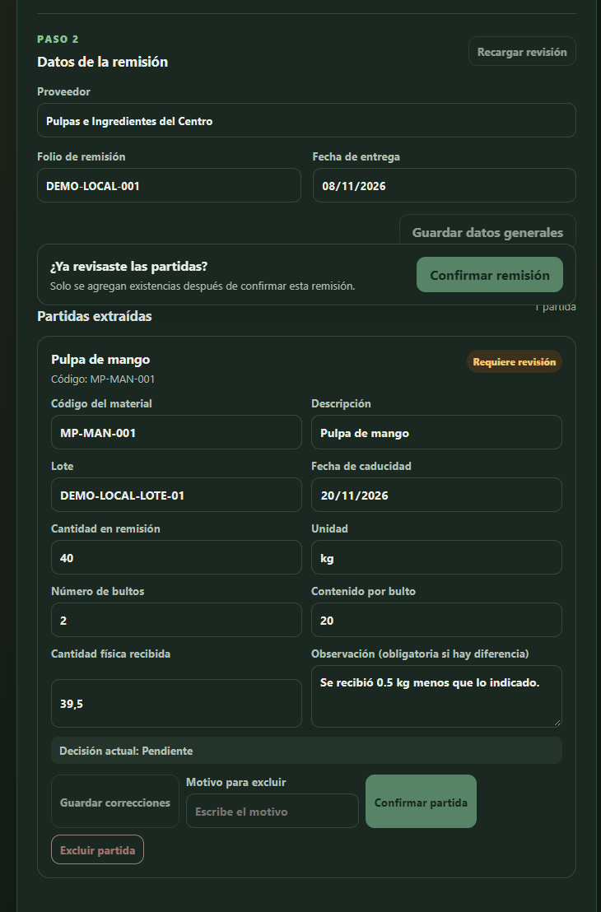

# 🚀 Frutalia SmartStock

**Frutalia SmartStock es un MVP académico orientado a la digitalización de la recepción de materiales y a la consulta inteligente de inventario mediante herramientas de inteligencia artificial.**

El proyecto fue desarrollado para la empresa ficticia **Frutalia Deliciosa** y propone apoyar al personal del almacén mediante dos capacidades principales: el procesamiento inteligente de remisiones y la consulta de existencias a través de un asistente conversacional de solo lectura.

La arquitectura del proyecto contempla que los datos obtenidos de las remisiones sean revisados y confirmados por una persona antes de afectar el inventario, manteniendo la decisión operativa bajo control humano.

## 📌 El Problema Resuelto

La recepción de materias primas, envases y embalajes puede depender de revisar documentos manualmente y volver a capturar sus datos en otros registros. Este trabajo repetitivo dificulta detectar errores en folios, cantidades, unidades, lotes o fechas de caducidad, especialmente cuando una remisión contiene varias partidas.

También existe un riesgo operativo: si una cantidad documentada se registra como recibida sin comprobar físicamente el material, las existencias pueden dejar de representar lo que realmente hay en el almacén. La consulta de inventario puede requerir, además, buscar información en distintos registros y conocer cómo interpretar mínimos, lotes o caducidades.

Frutalia SmartStock aborda estas necesidades dentro del alcance de un piloto académico:

- **El diseño propone reducir la captura manual inicial** mediante la extracción automatizada de datos de una remisión. Esta capacidad forma parte del alcance planteado, aunque no quedó operativa en la demostración final debido a la limitación de recursos de Azure.
- **Mantiene la revisión bajo control del empleado**, contemplando que los datos reconocidos automáticamente deban ser revisados antes de registrar una entrada en el inventario.
- **Propone evitar que borradores o documentos en revisión afecten las existencias**, separando el procesamiento documental de la confirmación de una entrada.
- **Facilita consultas de lectura** sobre existencias, caducidades, mínimos, lotes disponibles y entradas pendientes mediante un asistente conversacional.
- **Permite exportar a Excel la tabla de una consulta actual**, en lugar de ofrecer al empleado una exportación irrestricta del inventario completo desde el asistente.

## 💡 La Solución

La aplicación combina una interfaz web para el empleado, un backend modular, persistencia de datos y servicios de inteligencia artificial.

- **Interfaz:** HTML, CSS y JavaScript se sirven desde la aplicación Express. La pantalla principal reúne el área destinada a la revisión de remisiones y las consultas de inventario en una experiencia orientada al empleado.

- **Backend:** Node.js, TypeScript y Express organizan rutas y servicios para documentos, remisiones, inventario, asistente y exportaciones. Zod valida la configuración y las entradas; Vitest se utiliza para las pruebas.

- **Extracción documental:** el flujo fue diseñado para procesar archivos PDF e imágenes mediante Azure AI Document Intelligence, manteniendo temporalmente el archivo en memoria y descartándolo al finalizar. Sin embargo, esta integración no se encuentra operativa en la versión final demostrable debido al agotamiento de los créditos disponibles de Azure.

- **Revisión y reglas:** el flujo diseñado contempla que el empleado pueda corregir los datos de cabecera y partida obtenidos de la remisión, informar la cantidad física recibida y confirmar o excluir partidas. Las reglas de negocio fueron planteadas para ejecutarse en el backend antes de registrar una entrada. En la versión final demostrable, este flujo no se encuentra operativo al depender de la extracción documental que no pudo mantenerse disponible por la limitación de recursos de Azure.

- **Consultas conversacionales:** el asistente se integra con Microsoft Foundry Agent Service y sus herramientas se limitan a consultas de lectura controladas por el backend. No se ofrece al asistente una operación para modificar directamente el inventario.

- **Persistencia y exportación:** Azure SQL almacena los datos correspondientes al catálogo, remisiones e inventario utilizados por la aplicación. ExcelJS permite generar archivos Excel a partir de la tabla correspondiente a la consulta actual.

- **Operación:** la aplicación ofrece `/health` para comprobar que el servidor HTTP está activo. La solución contempla Azure App Service para el hospedaje de la aplicación y el uso de identidad administrada para los servicios compatibles.

El diseño separa la extracción automatizada de las decisiones que afectan al inventario: la IA propone información, el sistema aplica las reglas correspondientes y el empleado conserva la responsabilidad de confirmar la operación.

El proyecto tiene fines académicos y no incluye autenticación. Por este motivo, no debe utilizarse con información empresarial real ni considerarse una aplicación destinada a un entorno productivo.

## ⚠️ Alcance de la Implementación Final

El MVP fue diseñado para integrar dos capacidades principales de inteligencia artificial: la extracción documental de remisiones mediante **Azure AI Document Intelligence** y la consulta conversacional del inventario mediante **Microsoft Foundry Agent Service**.

Durante la etapa final del proyecto se presentó una limitación de recursos en el entorno académico de Azure debido al agotamiento de los créditos disponibles. Como consecuencia, no fue posible mantener operativa la integración necesaria para ejecutar el flujo completo de extracción documental.

Esta limitación afecta específicamente el procesamiento automático de remisiones y, por dependencia, las etapas posteriores de revisión, aplicación de reglas y confirmación de partidas derivadas de los datos extraídos.

Por lo tanto, estas funciones deben considerarse parte del **diseño y desarrollo del MVP**, pero no como funcionalidades operativas en la versión final demostrable.

La dependencia entre estas etapas puede representarse de la siguiente manera:

**Documento → Extracción → Revisión → Aplicación de reglas → Confirmación → Registro de entrada**

La indisponibilidad de la etapa de extracción impide continuar con las actividades posteriores que dependen de sus resultados. Por esta razón, no se consideran fallas independientes de los módulos de revisión o reglas, sino una consecuencia de la indisponibilidad del servicio previo requerido por el flujo.

Esta limitación no afecta al resto de los componentes implementados. La aplicación web, el backend, la persistencia disponible, las consultas de inventario, el asistente conversacional de solo lectura y las demás funciones descritas como operativas continúan funcionando de acuerdo con el alcance establecido.

Esta situación corresponde a una **restricción de infraestructura y disponibilidad de recursos en Azure**, y no a una modificación del diseño conceptual propuesto para Frutalia SmartStock.

## 📱 Aplicación del Proyecto y Funcionamiento

### 1. Abrir la pantalla de recepción

La aplicación presenta el espacio de trabajo del empleado con dos áreas principales: el espacio destinado al procesamiento y revisión de remisiones y el panel para realizar consultas al inventario.

El MVP no incluye un módulo visible de inicio de sesión, ya que la autenticación quedó fuera del alcance establecido para el proyecto académico.

_Pantalla principal de Frutalia SmartStock, con las áreas destinadas al procesamiento de una remisión y a la consulta del inventario._

### 2. Flujo diseñado para cargar y procesar una remisión

El flujo del MVP contempla que el empleado seleccione desde su computadora un archivo en formato **PDF, JPG, JPEG o PNG** para su procesamiento.

El servidor valida el archivo y la arquitectura contempla su envío al servicio de extracción documental mediante Azure AI Document Intelligence. Los datos reconocidos deberían utilizarse posteriormente como una propuesta para revisión y no como una entrada confirmada automáticamente.

Debido a la indisponibilidad del servicio de Azure requerido durante la etapa final del proyecto, la extracción automática no puede ejecutarse actualmente.

Por ello, esta sección representa el **flujo diseñado para el MVP** y no una funcionalidad disponible durante la demostración final.

_Representación del flujo diseñado desde la selección del documento hasta la propuesta de datos extraídos para su revisión._

_La captura muestra la sección de carga. La extracción automática no está disponible por la limitación de créditos de Azure._

### 3. Flujo diseñado de revisión, corrección y confirmación

Una vez obtenidos los datos mediante la extracción documental, el flujo contempla la revisión de los datos generales de la remisión, como proveedor, folio y fecha, así como los campos asociados a cada partida:

- Código.
- Descripción.
- Lote.
- Fecha de caducidad.
- Cantidad documentada.
- Unidad.

El diseño contempla que el empleado pueda corregir la información reconocida, registrar la **cantidad física recibida** y añadir una observación cuando exista una diferencia entre la cantidad documentada y la recibida físicamente.

Posteriormente, el empleado podría confirmar o excluir individualmente cada partida.

El objetivo de esta separación es impedir que la extracción realizada mediante inteligencia artificial modifique directamente el inventario. En el diseño planteado, únicamente una partida previamente revisada y confirmada por una persona puede generar una entrada.

Esta etapa depende de los resultados procedentes de la extracción documental y, por lo tanto, no se encuentra operativa en la versión final demostrable debido a la limitación de recursos de Azure anteriormente descrita.

_Representación de la interfaz diseñada para revisar los datos de las partidas, registrar cantidades físicas, realizar correcciones y confirmar o excluir individualmente cada partida.No disponible._

### 4. Consultar el inventario y exportar resultados

En el panel del asistente, el empleado puede escribir preguntas relacionadas con el inventario, incluyendo consultas sobre:

- Existencias.
- Caducidades.
- Materiales bajo mínimo.
- Lotes disponibles.
- Entradas pendientes.

El asistente utiliza herramientas de consulta controladas por el backend para obtener la información correspondiente.

Cuando una respuesta incluye una tabla, la interfaz permite exportar **esa tabla** a un archivo Excel.

El asistente funciona bajo un esquema de **solo lectura**: no cuenta con herramientas destinadas a confirmar entradas ni modificar directamente las existencias del inventario.

Esto mantiene separadas las consultas realizadas mediante inteligencia artificial de las operaciones que podrían modificar los datos del almacén.

## 🧪 Datos de demostración para probar el asistente

La siguiente tabla reúne los valores predefinidos en el catálogo de SQL para la demostración del asistente. El catálogo de demostración define 10 entradas confirmadas.

### Catálogo de materiales

| Código        | Material             | Proveedor del catálogo           | Unidad |      Mínimo | Ubicación | Presentación comercial | Requiere lote | Requiere caducidad |
| ------------- | -------------------- | -------------------------------- | ------ | ----------: | --------- | ---------------------- | ------------- | ------------------ |
| `MP-MAN-001`  | Pulpa de mango       | Pulpas e Ingredientes del Centro | kg     |          80 | Z-A       | Cubeta de 20 kg        | Sí            | Sí                 |
| `MP-GUA-001`  | Pulpa de guayaba     | Pulpas e Ingredientes del Centro | kg     |          80 | Z-A       | Cubeta de 20 kg        | Sí            | Sí                 |
| `MP-AGU-001`  | Agua purificada      | Producción interna               | litros | No definido | INTERNA   | No definida            | No            | No                 |
| `MP-AZU-001`  | Azúcar               | Pulpas e Ingredientes del Centro | kg     |          50 | Z-B       | Saco de 25 kg          | Sí            | Sí                 |
| `MP-ACI-001`  | Ácido cítrico        | Pulpas e Ingredientes del Centro | kg     |           5 | Z-B       | Bolsa de 5 kg          | Sí            | Sí                 |
| `MP-ASC-001`  | Ácido ascórbico      | Pulpas e Ingredientes del Centro | kg     |           2 | Z-B       | Bolsa de 1 kg          | Sí            | Sí                 |
| `MP-SOR-001`  | Sorbato de potasio   | Pulpas e Ingredientes del Centro | kg     |           2 | Z-B       | Bolsa de 1 kg          | Sí            | Sí                 |
| `ENV-BOT-001` | Botella de 250 ml    | Envases Transparencia Mexicana   | piezas |        1200 | Z-C       | Paquete de 100 piezas  | Sí            | No                 |
| `ENV-TAP-001` | Tapa para botella    | Envases Transparencia Mexicana   | piezas |        1200 | Z-C       | Bolsa de 500 piezas    | Sí            | No                 |
| `ENV-ETQ-001` | Etiqueta envolvente  | Envases Transparencia Mexicana   | piezas |        1200 | Z-D       | Rollo de 1,000 piezas  | Sí            | No                 |
| `EMB-CAJ-001` | Caja para 6 botellas | Empaques del Bajío               | piezas |         200 | Z-D       | Paquete de 25 piezas   | Sí            | No                 |

### Entradas confirmadas de demostración

| Folio                   | Proveedor                        | Código / material                    | Cantidad sembrada | Lote           | Caducidad desde la ejecución de la semilla | Estado     |
| ----------------------- | -------------------------------- | ------------------------------------ | ----------------: | -------------- | ------------------------------------------ | ---------- |
| `DEMO-AGENT-202611-001` | Pulpas e Ingredientes del Centro | `MP-MAN-001` — Pulpa de mango        |             60 kg | `DEMO-MAN-001` | 3 días                                     | Confirmada |
| `DEMO-AGENT-202611-002` | Pulpas e Ingredientes del Centro | `MP-GUA-001` — Pulpa de guayaba      |            100 kg | `DEMO-GUA-001` | 10 días                                    | Confirmada |
| `DEMO-AGENT-202611-003` | Pulpas e Ingredientes del Centro | `MP-AZU-001` — Azúcar                |             75 kg | `DEMO-AZU-001` | 60 días                                    | Confirmada |
| `DEMO-AGENT-202611-004` | Pulpas e Ingredientes del Centro | `MP-ACI-001` — Ácido cítrico         |              3 kg | `DEMO-ACI-001` | 25 días                                    | Confirmada |
| `DEMO-AGENT-202611-005` | Pulpas e Ingredientes del Centro | `MP-ASC-001` — Ácido ascórbico       |              3 kg | `DEMO-ASC-001` | 90 días                                    | Confirmada |
| `DEMO-AGENT-202611-006` | Pulpas e Ingredientes del Centro | `MP-SOR-001` — Sorbato de potasio    |              1 kg | `DEMO-SOR-001` | 45 días                                    | Confirmada |
| `DEMO-AGENT-202611-007` | Envases Transparencia Mexicana   | `ENV-BOT-001` — Botella de 250 ml    |       2000 piezas | `DEMO-BOT-001` | No aplica                                  | Confirmada |
| `DEMO-AGENT-202611-008` | Envases Transparencia Mexicana   | `ENV-TAP-001` — Tapa para botella    |        800 piezas | `DEMO-TAP-001` | No aplica                                  | Confirmada |
| `DEMO-AGENT-202611-009` | Envases Transparencia Mexicana   | `ENV-ETQ-001` — Etiqueta envolvente  |       1500 piezas | `DEMO-ETQ-001` | No aplica                                  | Confirmada |
| `DEMO-AGENT-202611-010` | Empaques del Bajío               | `EMB-CAJ-001` — Caja para 6 botellas |        250 piezas | `DEMO-CAJ-001` | No aplica                                  | Confirmada |

### Entrada pendiente de revisión

| Folio                       | Proveedor                        | Código / material              | Cantidad documentada | Lote            | Estado            | Confianza / revisión         |
| --------------------------- | -------------------------------- | ------------------------------ | -------------------: | --------------- | ----------------- | ---------------------------- |
| `DEMO-AGENT-202611-PENDING` | Pulpas e Ingredientes del Centro | `MP-ASC-001` — Ácido ascórbico |                 1 kg | Sin identificar | Requiere revisión | Amarillo / requiere revisión |

### Preguntas de ejemplo

Con estos registros puedes probar consultas permitidas como:

- “¿Qué materiales están por debajo del mínimo?”
- “¿Qué materiales caducan en los próximos 15 días?”
- “¿Cuántos kilogramos de pulpa de mango hay disponibles?”
- “¿Qué lotes de azúcar están disponibles?”
- “¿Hay entradas pendientes de revisión?”

Los resultados dependen de que la semilla de demostración se haya aplicado a la base utilizada por la aplicación.

## 🎯 Conclusión

El desarrollo de **Frutalia SmartStock** representó para mí un reto importante, no solamente desde el punto de vista técnico, sino también personal. Durante el periodo destinado al proyecto atravesé diversas dificultades que redujeron considerablemente el tiempo que pude dedicar a su desarrollo. A pesar de estas circunstancias, logré retomar la propuesta, definir un alcance viable y llevarla hasta un MVP funcional en varios de sus componentes principales.

Uno de los aspectos más valiosos del proyecto fue la oportunidad de experimentar de manera práctica con distintas herramientas de inteligencia artificial. La IA no estuvo presente únicamente como una funcionalidad dentro de Frutalia SmartStock, sino también como una herramienta de apoyo durante su desarrollo. Esto me permitió explorar diferentes formas de utilizarla para analizar problemas, estructurar ideas, definir componentes, apoyar el desarrollo de la aplicación y comprender mejor la integración entre distintos servicios.

El proyecto también representó un acercamiento mucho más práctico al ecosistema de **Microsoft Azure**. Durante el desarrollo aprendí que trabajar con servicios en la nube implica no solamente conocer su configuración e integración, sino también administrar adecuadamente los recursos disponibles. Las diferentes pruebas y llamadas realizadas a los servicios fueron consumiendo progresivamente los créditos de Azure asignados al proyecto, hasta limitar la posibilidad de continuar utilizando algunos de ellos.

Si bien el resultado final no incluye todas las funcionalidades originalmente planteadas en estado operativo, considero significativo haber logrado construir y levantar el proyecto dentro de las condiciones y el tiempo disponibles. Frutalia SmartStock me permitió pasar de una idea inicial a una solución estructurada, integrar diferentes tecnologías y comprobar de forma práctica varias aplicaciones de la inteligencia artificial.

Más allá del resultado técnico, este proyecto me deja un aprendizaje importante sobre adaptación, administración de recursos y resolución de problemas. También me permitió identificar con mayor claridad aspectos que en un futuro abordaría de manera diferente, como la planeación del consumo de servicios en la nube y la optimización de las pruebas.

Finalmente, considero que uno de los principales logros de este proyecto fue haber continuado avanzando a pesar de las dificultades encontradas. El resultado obtenido representa no solo lo que fue posible desarrollar técnicamente, sino también el conocimiento adquirido a lo largo del proceso. Me llevo una comprensión mucho más amplia sobre inteligencia artificial, desarrollo e integración de servicios en Azure y, sobre todo, la experiencia de haber enfrentado un proyecto complejo, adaptarlo a las circunstancias y llevarlo hasta un resultado concreto.
